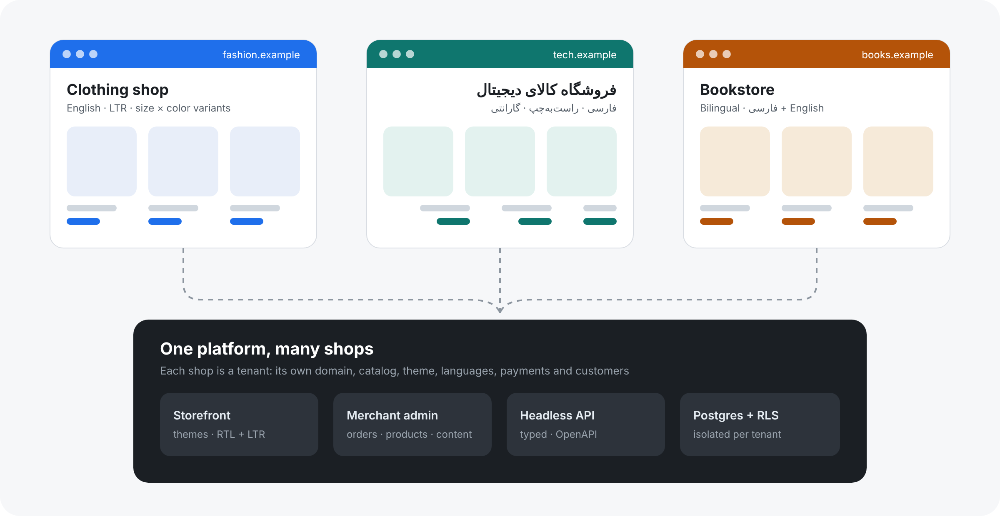

# Headless App

A multi-tenant, headless e-commerce platform. One codebase runs many independent shops,
each with its own domain, catalog, look, languages, payment details and customers.
Clothing, electronics, books, cosmetics, food, pet supplies: the kind of shop is
configuration, not code.



## What it gives a shop

- **A storefront** with themes made of configurable sections, in right-to-left and
  left-to-right languages (Persian and English at launch, more by adding a locale).
- **A merchant admin** that works well on a phone: orders, products and variants,
  categories, discounts, shipping rates, content, sales insights.
- **A headless API** (typed, documented with OpenAPI) that the storefront itself uses, so
  a custom frontend, mobile app or bot can be built on the same backend.
- **Checkout built for the Iranian market**: integer Toman pricing, Jalali dates,
  phone-OTP sign-in, Zarinpal, card-to-card transfer with receipt review, per-province
  shipping and local courier delivery, and Persian-aware search.
- **Configurable catalog**: product types with their own attributes, filters and variant
  options (size × color, warranty, author, …), set up from presets per kind of shop.

## How it is built

| Layer | Choice |
| --- | --- |
| App | Next.js 16 (App Router, React 19), TypeScript strict |
| API | Hono with `@hono/zod-openapi`, Scalar reference at `/api/reference` |
| Data | PostgreSQL with Drizzle; every shop's rows isolated by row-level security |
| Auth | Better Auth, phone one-time codes |
| UI | Tailwind CSS v4, logical properties for RTL and LTR |
| Quality | Vitest (unit, integration against real Postgres, components), Playwright E2E at desktop and phone widths, GitHub Actions CI |
| Runtime | Node 24, pnpm 11, Docker; runs anywhere a container runs |

Design decisions are recorded in [`docs/adr/`](docs/adr):
[architecture](docs/adr/0001-architecture.md),
[per-shop customers and sign-in](docs/adr/0002-tenant-auth.md),
[tenant isolation and secrets](docs/adr/0003-rls-contract.md),
[languages and text direction](docs/adr/0004-languages-and-direction.md).

## Status

The platform grows out of a single-shop codebase that is already in production. It is
being turned multi-tenant in phases:

| Phase | Goal |
| --- | --- |
| 0 | Decide: architecture, isolation and auth design, CI. **Done** |
| 1 | Tenant-aware core: many shops on their own domains, isolation proven by tests, two languages |
| 2 | Configurable catalog and vertical presets |
| 3 | Themes and merchant settings, no code needed to brand a shop |
| 4 | Self-signup, plans and billing, platform admin |
| 5 | First pilot shops live |
| 6 | Public headless API: SDK, API keys, webhooks, first-party plugins |

Until Phase 1 lands, the app still runs as a single shop. The current stories are in
[`docs/phase-1-stories.md`](docs/phase-1-stories.md), and the module-by-module plan in
[`docs/extraction-map.md`](docs/extraction-map.md).

## Run it locally

```bash
cp .env.example .env                # fill APP_CONFIG_AUTH_SECRET (openssl rand -hex 32)
pnpm install
pnpm app:dev                        # dev Postgres (Docker) + Next on http://localhost:3000
pnpm migration:migrate              # first run, in a second terminal
pnpm seed-catalog && pnpm seed-shipping
pnpm create-admin 09121234567       # grant admin to a phone number
```

| URL | What |
| --- | --- |
| `http://localhost:3000` | Storefront |
| `http://localhost:3000/admin-panel` | Merchant admin (sign in at `/login`; the one-time code prints in the server log) |
| `http://localhost:3000/api/reference` | Interactive API docs (non-production) |

No third-party account is needed locally: SMS goes to the console, uploads to local disk,
and payments to a mock gateway.

## Contributing

Conventions, quality gates and the rules every change follows are in
**[AGENTS.md](./AGENTS.md)**. Every pull request runs type-check, lint, format, unit and
integration tests against Postgres, Playwright and a production build.
